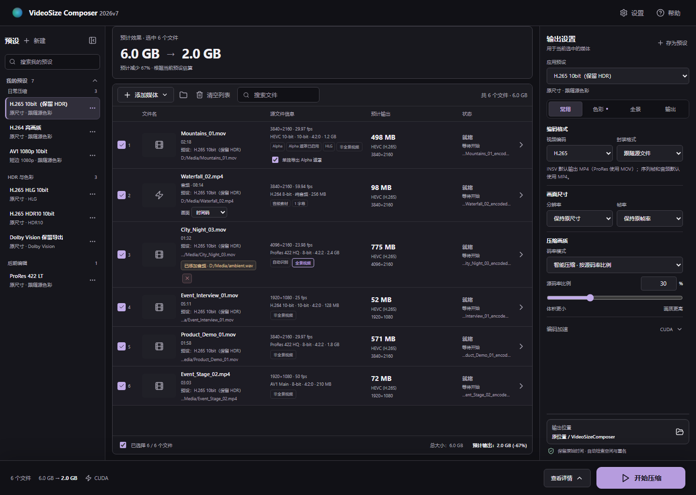
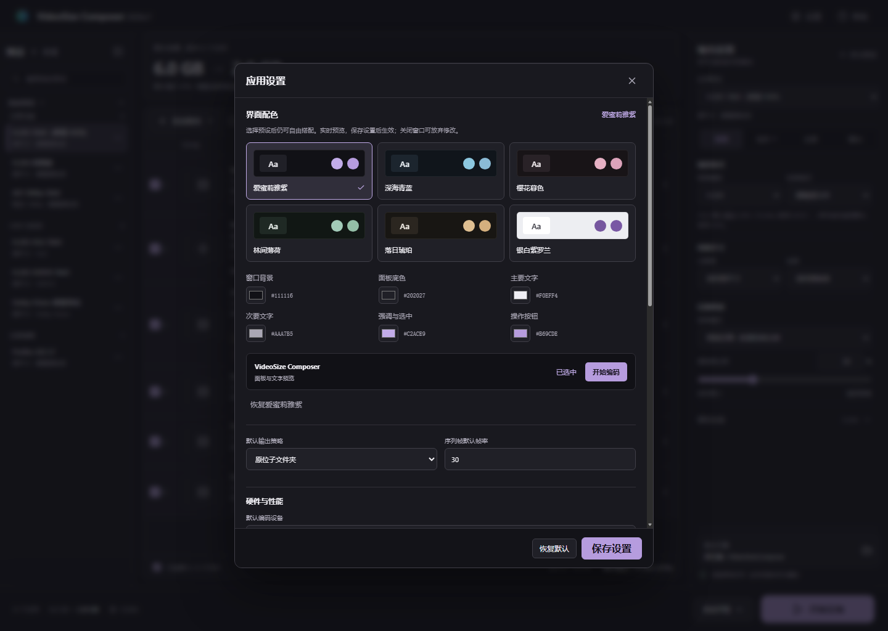
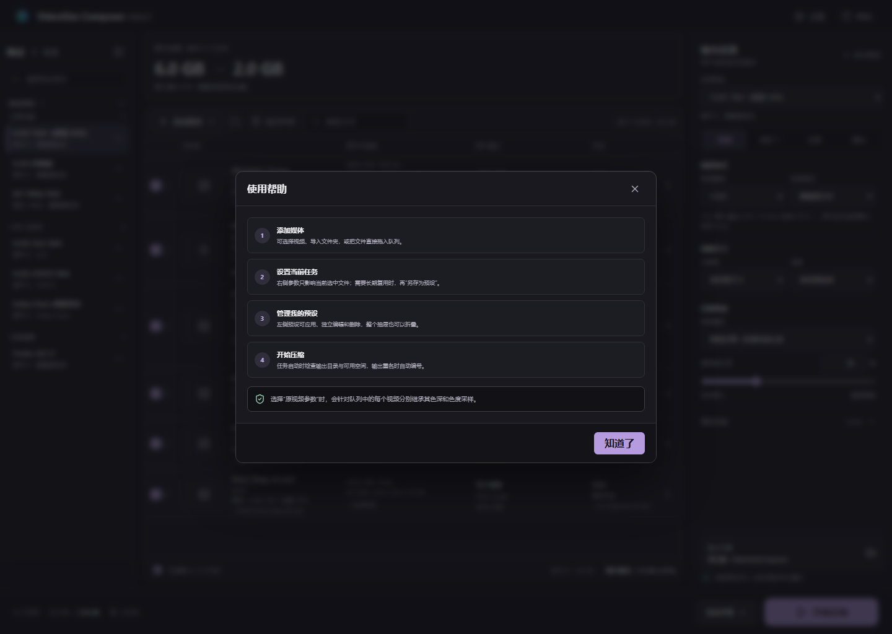

# VideoSize Composer

VideoSize Composer 是一个便携式桌面批量视频编码器。它使用 Tauri v2、React、TypeScript 和 Rust 构建，提供紧凑的液态玻璃工作台，用于导入媒体、配置当前任务并批量压缩视频。

## 界面预览

以下截图来自当前开发版界面，素材保存在 [`assets/readme/`](assets/readme/)：

### 工作台



### 应用设置



### 使用帮助



## 核心流程

1. **添加媒体** — 选择视频、导入文件夹或序列帧媒体，或直接拖放文件；支持批量任务。
2. **选择输出** — 为当前任务选择预设、编码格式、分辨率、画质、色彩和输出命名策略。
3. **开始压缩** — 查看预计大小、剩余时间和任务详情；编码完成、失败或取消都会进入明确的终态。

## 功能特性

- 支持 H.264、H.265/HEVC、AV1 和 ProRes 422 LT；支持源分辨率、短边分辨率、10%–90% 倍率缩放和自定义宽高。
- 输出帧率默认保持源帧率，也可统一为常见帧率（23.976/24/25/29.97/30/50/59.94/60）或输入自定义值。
- 支持从文件夹或任意一帧识别序列帧媒体，并可逐序列设置帧率、分辨率和像素宽幅放大率。
- 输出封装默认保持源后缀（序列帧默认 MP4），也可选择 MP4、MOV、AVI、MKV、WebM、M4V 或 M4A。
- 支持 8/10-bit、4:2:0/4:2:2，以及 SDR、HLG 和 HDR10 色彩模式。
- 通过 FFmpeg `zscale` 完成 HDR/SDR 像素转换并写入匹配的色彩元数据；HDR 转换和 4:2:2 使用 CPU 路径以提高可预测性。
- HLG→SDR 默认“自动”色调映射：按源亮度元数据与实测编码域峰值，在 BT.2408 直映射（贴近原始 SDR 亮度）和软膝压缩高光之间选择，也可手动固定为直映射、软膝或硬截顶。
- 未写色彩元数据的宽色域 10-bit 素材标记为「HDR（未标注）」并在任务详情提供「源色彩解释」（自动 / SDR / HLG / HDR10），确认前始终按 SDR 编码，避免误判导致画面变灰或变暗。
- Dolby Vision 保留模式使用无损 HEVC stream copy 保留已有 RPU；该模式不允许缩放或 LUT 处理，也不会生成新的 Dolby Vision 元数据。
- 可导入 `.cube`、`.3dl` 和 `.lut` 文件，并将 LUT 与预设一起保存。
- 识别带全景标签的源视频和 2:1 等距柱状候选；全景输出写入 Google Spherical Video V1 与标准 V2 `st3d`/`sv3d` 元数据，并通过 ffprobe 回读验证。
- 支持导入 Insta360 `.insv`，自动配对旧机型的 `_00_` / `_10_` 双原片并合并为一个任务。预设的“全景”页可保存 FlowState 防抖、方向锁定、光流／动态／AI 拼接、镜头间色彩融合及降噪偏好。
- INSV 视频导出需要另行部署官方 Desktop Media SDK：先由 SDK 拼接为 2:1 全景中间视频，再按输出预设编码为所选格式；“跟随源文件”对 INSV 默认使用 MP4（ProRes 使用 MOV）。不输出可继续编辑的 INSV 原片。
- 可保存、编辑和删除“我的预设”；预设库与右侧当前任务的输出设置相互独立。
- 预设侧栏采用紧凑分组，可搜索名称、编码与参数并记忆折叠状态；任务设置和预设编辑器统一为“常用 / 色彩 / 输出”三个页签，支持码率数值输入和命名预览。
- 可选择全部输出到指定目录、原位输出或原位子文件夹，并支持原名或前后缀命名。
- 默认保留源视频的创建日期和修改时间；Windows 与 macOS 会分别写入并回读验证。
- 启动编码前检查输出目录可写性和剩余空间；重名文件使用可预测的数字后缀处理。
- 编码使用同目录临时文件，成功后才移动到最终路径；失败、取消时会清理临时文件。
- 运行中的任务可以取消；任务详情、日志和错误状态保持可见。

## 平台行为

- Windows 显示 `CUDA`、`Auto` 和 `CPU`，不显示 Metal。
- macOS 显示 `Metal`、`Auto` 和 `CPU`，不显示 CUDA。
- 其他平台显示 `Auto` 和 `CPU`。

## 默认预设

- H.265 10bit（保留 HDR）
- H.264 高画质
- AV1 1080p 10bit
- ProRes 422 LT
- H.265 HLG 10bit
- H.265 HDR10 10bit
- Dolby Vision 保留导出

## 技术栈

- Tauri v2 桌面壳
- React + TypeScript + Vite 前端
- Rust 后端命令负责平台检测、预设、ffprobe 元数据、FFmpeg 命令构建、编码进度和时间戳验证
- FFmpeg / ffprobe 从 `PATH` 获取，或随打包应用一起内置

## 开发

开始原生开发前，请安装 Rust stable、Node.js 或 pnpm，以及对应平台的 WebView2/Xcode 工具链。

```powershell
pnpm install
pnpm tauri dev
```

构建前端：

```powershell
pnpm build
```

## 便携版构建

```powershell
pnpm build:portable
```

Windows 便携版会生成到 `dist/VideoSizeComposer`，直接运行其中的 `VideoSizeComposer.exe`。最终打包步骤会把 FFmpeg 和 ffprobe 放在应用旁边。

### Insta360 SDK 部署

官方 SDK 需要通过 [Insta360 开发者申请](https://www.insta360.com/sdk/apply) 审核后获得下载链接；公开 GitHub 仓库只有示例与文档。已安装的 Insta360 Studio 不等于安装了独立 Media SDK。

使用带 `-model_root_dir` 参数的新版官方 `MediaSDKTest`，将 Windows SDK 的完整 `bin/` 内容（可执行程序、依赖 DLL、`models/`）放到便携程序旁的 `insta360/` 目录，也可在“应用设置 → Insta360 全景处理”中选择 SDK 根目录或 `bin/`。支持通过 `INSTA360_MEDIA_SDK_DIR` 环境变量指定目录。开发时可将完整 bin 内容放入 `vendor/insta360/`，构建脚本会复制到便携包；SDK 不提交到仓库。

防抖、方向锁定、拼接与降噪仅对 INSV 原片生效，普通全景 MP4 不会重复拼接。AI 拼接和降噪需要 SDK 配套模型，部分功能还受拍摄机型及 SDK 版本限制。官方桌面 Media SDK 支持 Windows/Linux，当前 macOS 需先通过 Studio 导出全景 MP4。SDK 的运行环境及参数以 [官方文档](https://insta360develop.github.io/Insta360-Developer_Docs/en/x/desktop/media/) 为准。

拼接使用原全景尺寸和至少 80 Mbps 的 HEVC 中间视频，再进行最终编码，会增加一次有损编码与临时空间占用。预检查同时计算中间文件空间，拼接输出会核对尺寸、时长、位深、HDR 和音轨；失败或取消清理中间文件，不会将未拼接的鱼眼画面当成成功输出。自定义全景输出尺寸必须是 2:1，宽为 4 的倍数。MP4/MOV/M4V 写入并回读验证全景标记，其他封装的播放器识别需另行确认。

验证边界：自动测试以人工构造的多视频轨 MP4/INSV 验证配对、队列参数、转码、全景标记及 SDK 进程取消；不代表真实相机标定、FlowState 或 AI 拼接画质已经验收，仍需官方 SDK 与真实 INSV 样片验证。

macOS `.app` 包请在 macOS 上构建：

```bash
pnpm build:mac
```

## 验证

```powershell
pnpm build
cd src-tauri
cargo test
cd ..
powershell -ExecutionPolicy Bypass -File .\qa\hlg\verify-hlg.ps1
```

Rust 测试覆盖编码器组合、HDR、LUT、全景元数据、导入、重名、临时文件、取消任务，以及创建/修改时间独立恢复等关键路径。

`qa/hlg/verify-hlg.ps1` 用随应用分发的 FFmpeg 复现 HLG 链路并逐项断言：HLG 标签落地、编码域峰值抽样分档、SDR 参考素材的 BT.2408 直映射亮度保持、满量程素材的软膝压缩、`tonemap` 各算法可用性、MDCV/MaxCLL 读取与未标注素材判定，全部通过时退出码为 0。测量结论见 `qa/hlg/verification.md`。
